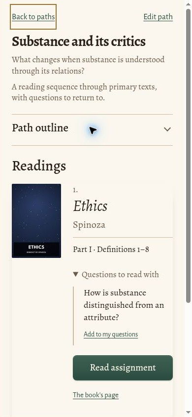

# Reading paths design QA

Result: passed — 2026-10-25.

Implemented the selected second design direction in the existing static app. A path now opens a dedicated syllabus with its description, collapsible outline, selected reading, chapter assignment, questions and reading action. Other readings remain compact and selectable. Desktop places the outline beside the readings; phones stack it above them.

## Visual comparison

Compared the selected 853 × 1844 reference image with the rendered mobile page at 390 × 844 CSS pixels, and inspected the desktop rendering at 1365 × 936. The committed mobile capture shows the outline folded to expose the question and reading action. Expanded outline and changing readings were also checked in the browser.

- Retained the ivory background, serif hierarchy, green action, fine rules, italic book titles and cover/metadata alignment.
- Used actual edition covers. Missing artwork is omitted. The preview uses synthetic path metadata and an existing bundled public-domain book cover.
- Kept the existing Alegreya typography and accessible light/dark palette.
- Used “Readings” rather than inventing a primary/secondary classification not present in the path's records.
- Retained “Add to my questions”, the book-page link and chapter-status information. These functional controls make the page longer than the concept image.
- Fixed native grey button styling, overly loose mobile spacing and header density during visual review.
- No unresolved P0/P1/P2 issues. This is an integration of the chosen direction, not a pixel-identical recreation of its invented cover art or example text.

## Verification

- `python3 tests/smoke.py`: passed, including focused custom path at phone/desktop widths, backup round trip and offline shell.
- `python3 tests/study_tools.py`: passed, including path editing, export/import/delete, chapter opening, question notes, keyboard selection and outline collapse across renders.
- `python3 tests/contrast.py`: passed, including focused custom and built-in paths in light and dark schemes.
- Browser: selected both readings, folded the outline, checked actual cover rendering, mobile layout and desktop sidebar layout.
- `git diff --check`: passed.

No stored-record or service-worker changes.

