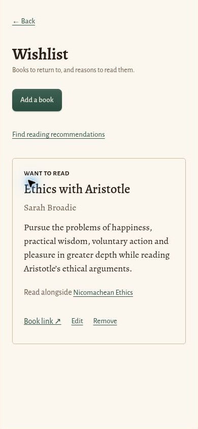

# Wishlist and companion books — verified 2026-10-25

Wishlist records contain title, author, an optional catalogue link, a reading note, an optional shelf-book association, wanted/obtained status, and timestamps. They live in a separate store (database version 10), travel in backups (version 7), and use the existing Recently deleted transaction and Undo.

Recommendations are local editorial matches against both title and author. Reading books sort ahead of other shelf entries, followed by wishlist books. General recommendations exclude owned copies; a book's companion view can open an owned copy. Unknown works show an explicit empty state and allow manual companion selections. No library or annotations are transmitted to a recommendation service.

Initial coverage: eight companions for Spinoza's Ethics, Aristotle's Nicomachean Ethics, Deleuze's Difference and Repetition, Deleuze and Guattari's A Thousand Plateaus, Kant's Groundwork, and Nietzsche's Genealogy. Every entry carries a source link. Pairing explanations are editorial suggestions, not publisher quotations or consensus claims. Sources were checked against publisher/author listings; City Lights' indexed catalogue confirmed the Deleuze title, while direct page retrieval returned 403. Full titles are retained for deduplication so different works beginning “Spinoza:” remain distinct.

Validation passed:
- smoke.py — phone/desktop screens, backup/wipe/restore including wishlist, and the offline shell.
- discovery.py — version 9 migration, safe links and escaped text, persistence, manual links, owned-book handling, title/author disambiguation, wishlist-based matches, obtained status, delete/Undo, and 320/390/1280 px layouts.
- trash.py — version 7 migration and all existing deletion/restore regression checks.
- contrast.py — light and dark schemes, including wishlist and all recommendation cards.
- Browser — saved an actual catalogue recommendation in the disposable preview, opened the wishlist and inspected the resulting entry and companion link at 390 × 844 CSS pixels.

